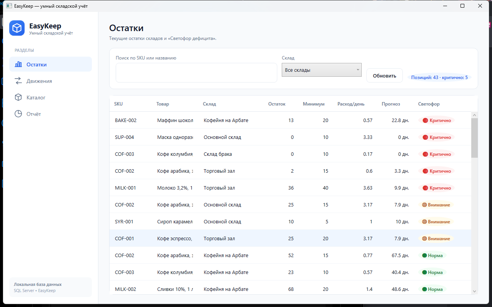
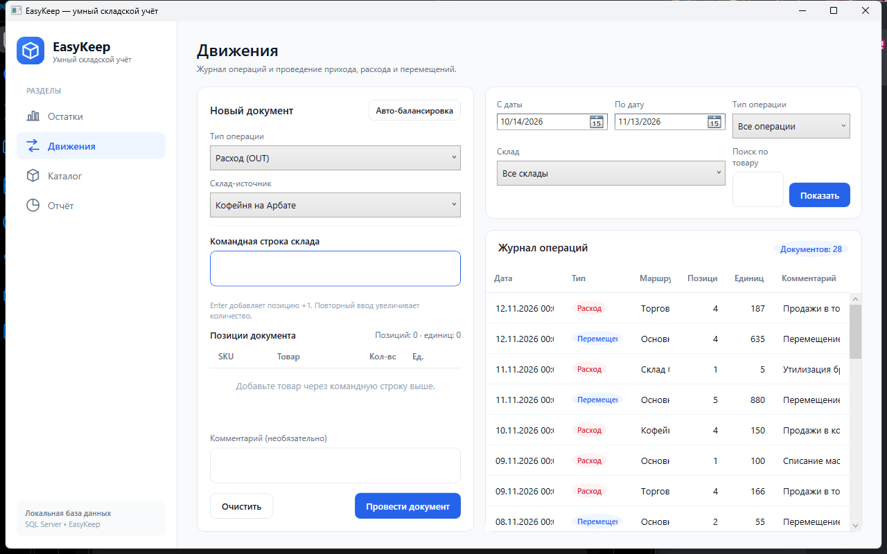
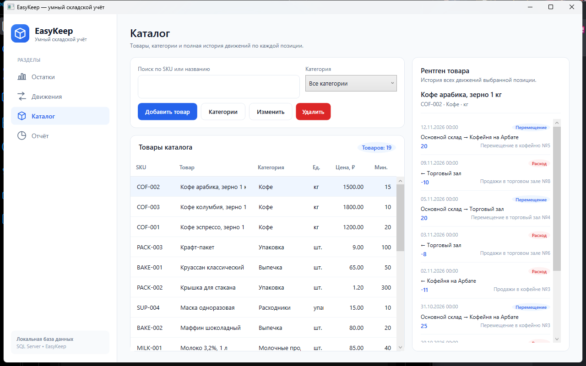
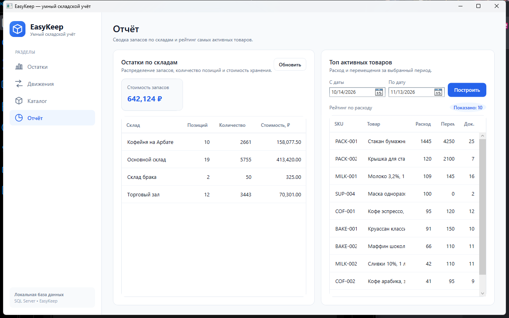

# EasyKeep — Складской учёт

Междисциплинарная проектная работа № 2 «Разработка настольной информационной системы».

## Автор и тема

| Поле | Сведения |
| --- | --- |
| ФИО | Соловьёв Захар Олегович |
| Курс | 3 курс |
| Группа | [Номер группы] |
| Тема | EasyKeep — Складской учёт |
| Срок выполнения | 27.10.2026 — 24.11.2026 |
| Формат | Индивидуальная работа |

## Назначение системы

**EasyKeep** — настольная информационная система для локального складского учёта и управления товарными потоками между точками хранения. Система ведёт каталог товаров с артикулами (SKU), категориями, ценами и минимальным неснижаемым остатком, хранит остатки по нескольким складам и оформляет многопозиционные документы прихода, расхода и перемещения.

Приложение рассчитано на небольшой розничный магазин, кофейню, пекарню или сервисный центр, где важно быстро принимать товар, перемещать его в торговый зал и заранее видеть дефицит. Вместо разрозненных таблиц Excel EasyKeep обеспечивает целостность остатков, запрет отрицательных значений, прозрачную историю операций и прогноз расхода на основе фактических движений за последние 30 дней. Работа полностью автономна: данные хранятся в локальном Microsoft SQL Server, интернет и облачные подписки не требуются.

## Реализованные возможности

| Возможность | Краткое описание | Состояние |
| --- | --- | --- |
| Каталог товаров и категорий | Создание, изменение и удаление товаров (SKU, название, категория, единица измерения, цена, `min_stock`) и категорий; защита от удаления связанных записей, уникальность SKU и названий. | Реализовано и проверено |
| Остатки по складам | Таблица остатков в разрезе «склад — товар» с JOIN-выборкой, фильтром по складу и поиском по SKU/названию; сообщение при отсутствии результатов. | Реализовано и проверено |
| Светофор дефицита и прогноз | Среднедневной расход за 30 дней, прогноз дней до обнуления и статусы 🟢 норма / 🟡 внимание / 🔴 критично / ⚪ неликвид. | Реализовано и проверено |
| Приход, расход и перемещение | Многопозиционные накладные; проведение в одной транзакции `SqlTransaction`, проверка остатка с блокировкой `WITH (UPDLOCK, ROWLOCK)`, полный откат при ошибке. | Реализовано и проверено |
| Журнал движений | Хронологическая лента документов с фильтрами по периоду, типу, складу и поиском по товару через связанные таблицы. | Реализовано и проверено |
| «Командная строка склада» | Ввод SKU или названия в постоянное поле и `Enter` добавляет товар в документ с количеством 1; повторный ввод увеличивает количество. Подходит для USB-сканера. | Реализовано и проверено |
| «Рентген товара» | Боковая панель истории всех движений выбранного товара: дата, тип, маршрут, количество, комментарий. | Реализовано и проверено |
| Авто-балансировка складов | Формирование черновика перемещения дефицитных товаров с основного склада на торговые точки с предпросмотром и подтверждением. | Реализовано и проверено |
| Аналитический отчёт | Сводка остатков, количества и стоимости по складам и топ-10 активных товаров за выбранный период. | Реализовано и проверено |
| Умная валидация | При нехватке остатка показывается доступный максимум и предлагается подставить его; пустые и некорректные поля отклоняются с понятным сообщением. | Реализовано и проверено |

## Технологии и зависимости

| Компонент | Версия / сведения |
| --- | --- |
| Windows | Windows 10 Pro, сборка 26300 (проверено); требуется Windows 10/11 |
| .NET | SDK 10.0.404, целевая платформа `net10.0-windows` |
| Интерфейс | WPF (C#) |
| Microsoft SQL Server | Microsoft SQL Server 2025 Express (LocalDB `17.0.4025.3`); совместимо с SQL Server 2019 и новее |
| Microsoft.Data.SqlClient | 7.1.1 (чистый ADO.NET для транзакций и отчётов) |
| Entity Framework Core | `Microsoft.EntityFrameworkCore.SqlServer` 10.0.15 (справочники, фильтрация, прогноз) |
| Среда разработки | .NET CLI 10.0.404, Visual Studio 2022+ или VS Code |
| Другие зависимости | Дополнительных пакетов нет |

## Структура репозитория

```text
EasyKeep/
├── src/
│   ├── EasyKeep.sln                     # решение
│   ├── README.md                        # описание исходного кода
│   └── EasyKeep/                        # WPF-проект
│       ├── Data/                        # AppConfig, EasyKeepContext (EF Core), AdoNetMovementRepository
│       ├── Services/                    # каталог, движения, дефицит, авто-балансировка, отчёты
│       ├── Views/                       # главное окно и экраны «Остатки», «Движения», «Каталог», «Отчёт»
│       ├── Styles.xaml                  # дизайн-система
│       ├── appsettings.json             # общая конфигурация без секретов
│       └── appsettings.Local.example.json
├── database/
│   ├── README.md                        # порядок развёртывания и проверки БД
│   ├── schema.sql                       # создание базы, 6 таблиц, ключей, ограничений и индексов
│   └── seed.sql                         # учебные данные и история движений за 30 дней
├── docs/
│   ├── requirements.md                  # требования, сценарии, BR, TX-01, границы
│   ├── database-schema.md               # описание модели данных
│   ├── database-schema.svg              # ER-диаграмма
│   └── testing.md                       # 8 тест-кейсов с фактическими результатами
├── screenshots/
│   ├── stocks.png
│   ├── movements.png
│   ├── catalog.png
│   └── reports.png
├── START_HERE.md                        # инструкция и календарь преподавателя
├── README.md
└── .gitignore
```

## Запуск на другом компьютере

### 1. Подготовка

1. Установите **.NET SDK 10** (проверено на 10.0.404) и **Microsoft SQL Server 2019+ Express** либо **LocalDB** (входит в состав SQL Server Express и Visual Studio).
2. Склонируйте репозиторий или распакуйте архив проекта.
3. Откройте терминал в корне репозитория и восстановите зависимости:
   ```powershell
   dotnet restore src/EasyKeep.sln
   ```

### 2. Развёртывание базы данных

1. Подключитесь к своему экземпляру SQL Server в SSMS или `sqlcmd`. Для LocalDB:
   ```powershell
   sqlcmd -S "(localdb)\MSSQLLocalDB" -E -C
   ```
2. Выполните `database/schema.sql` — он сам создаст базу `EasyKeep`, если её нет, и создаст 6 таблиц, ключи, ограничения и индексы.
3. Выполните `database/seed.sql` — он загрузит 7 категорий, 19 товаров, 4 склада, 28 документов и 129 строк движений за 30 дней.
4. Проверьте результат:
   ```sql
   SELECT COUNT(*) FROM dbo.items;      -- 19
   SELECT COUNT(*) FROM dbo.warehouses; -- 4
   SELECT SUM(quantity) FROM dbo.stocks; -- 11909
   ```
   Подробные проверочные запросы и ожидаемые значения — в [инструкции по базе данных](database/README.md).

Повторный запуск скриптов безопасен: существующая база и данные не удаляются, а `seed.sql` пропускает повторную загрузку.

### 3. Настройка подключения

Приложение читает строку подключения из `src/EasyKeep/appsettings.Local.json` (файл исключён из Git), затем из `appsettings.json`. Если настройка отсутствует или пуста, автоматически используется фоллбэк:

```text
Server=(localdb)\MSSQLLocalDB;Database=EasyKeep;Trusted_Connection=True;TrustServerCertificate=True
```

Для другого экземпляра скопируйте `src/EasyKeep/appsettings.Local.example.json` в `appsettings.Local.json` и укажите свой сервер:

```json
{
  "ConnectionStrings": {
    "EasyKeep": "Server=(localdb)\\MSSQLLocalDB;Database=EasyKeep;Integrated Security=True;TrustServerCertificate=True"
  }
}
```

Например, для именованного экземпляра: `Server=localhost\\SQLEXPRESS;Database=EasyKeep;Integrated Security=True;TrustServerCertificate=True`. Пароли и реальные строки подключения в репозиторий не добавляются. При ошибке подключения приложение показывает понятное сообщение без деталей конфигурации.

### 4. Запуск приложения

1. Соберите решение:
   ```powershell
   dotnet build src/EasyKeep.sln
   ```
2. Запустите проект:
   ```powershell
   dotnet run --project src/EasyKeep/EasyKeep.csproj
   ```
   Либо откройте `src/EasyKeep.sln` в Visual Studio, выберите проект `EasyKeep` запускаемым и нажмите `F5`.
3. Откроется главное окно «EasyKeep — умный складской учёт» с разделом «Остатки». Если таблица содержит 43 строки остатков и 4 склада, подключение к реальной БД работает. Проверка чтения: откройте «Отчёт» — итог должен быть **11 909 единиц** и **642 123,50 ₽**.

## Бизнес-правила и транзакция

- **BR-01. Неотрицательный остаток.** Расход или перемещение не могут превысить фактический остаток на складе-источнике. Проверка выполняется внутри транзакции после чтения строки `stocks` с блокировкой `WITH (UPDLOCK, ROWLOCK)`; при нехватке выбрасывается `InsufficientStockException`, интерфейс показывает доступный максимум и предлагает подставить его.
- **BR-02. Полнота и однозначность накладной.** Документ содержит минимум одну позицию, количество больше нуля, один товар не повторяется, для перемещения склады отправления и получения различаются. Проверяется до транзакции и повторно ограничениями БД.
- **BR-03. Уникальность и защита связей.** SKU товара и название категории уникальны; нельзя удалить товар, используемый в остатках или движениях, и категорию, в которой есть товары.
- **BR-04. Прогноз дефицита.** Товар критичен, если остаток ниже `min_stock` или его хватит не более чем на 2 дня; при нулевом расходе за 30 дней товар считается неликвидом.
- **BR-05. Авто-балансировка.** Пополнение торговой точки выполняется только до `min_stock` и только из излишка основного склада; один товар не распределяется дважды.
- **BR-06. Достоверность отчёта.** Суммы и количества рассчитываются SQL-агрегацией по фактическим остаткам и движениям за выбранный период.

- **TX-01. Проведение перемещения.** Шапка `movements`, строки `movement_items`, уменьшение остатка отправителя и увеличение остатка получателя выполняются в одной транзакции `SqlTransaction` (`ReadCommitted`). Остаток читается с блокировкой `UPDLOCK, ROWLOCK`; при нехватке хотя бы одной строки вызывается `Rollback`, и не сохраняется ничего, включая уже применённые строки. Успешная операция фиксируется `Commit`.

Подробное описание правил, сценариев и шагов TX-01: [требования](docs/requirements.md).

## Скриншоты

### Остатки и «Светофор дефицита»



### Движения, командная строка и журнал операций



### Каталог товаров и панель «Рентген товара»



### Аналитический отчёт



## Документация и проверка

- [Требования, бизнес-правила и границы проекта](docs/requirements.md)
- [Модель данных и описание ограничений](docs/database-schema.md)
- [ER-диаграмма (SVG)](docs/database-schema.svg)
- [Тестовые сценарии и фактические результаты](docs/testing.md)
- [Развёртывание базы данных](database/README.md)
- [Описание исходного кода](src/README.md)

## Известные ограничения

- Приложение рассчитано на одно локальное рабочее место: нет аутентификации, разграничения ролей и одновременной работы нескольких пользователей через сервер приложений.
- Не реализованы закупочные накладные поставщиков, взаиморасчёты, кассовое и налоговое ПО, печать этикеток, генерация штрихкодов и экспорт отчётов в Excel/PDF.
- Удаление документов движения в интерфейсе не предусмотрено: история операций рассматривается как неизменяемая. Удаление справочников ограничено связанными записями.
- Авто-балансировка формирует черновик по текущим остаткам и расходу за 30 дней; ручная корректировка перед проведением остаётся за пользователем.
- Дефектов при выполнении восьми тест-кейсов не обнаружено; фактические результаты и восстановление чистой БД описаны в [отчёте по тестированию](docs/testing.md).
