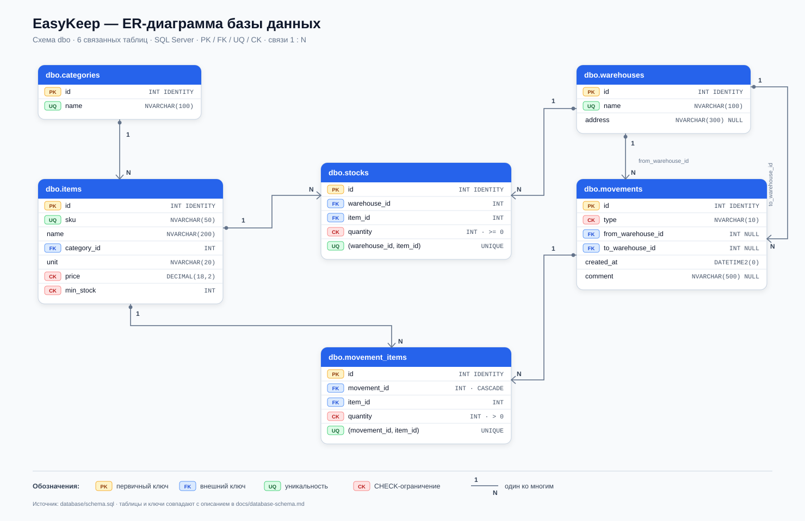

# Модель данных системы «EasyKeep — Складской учёт»

Автор: Соловьёв Захар Олегович, 3 курс, группа [Номер группы].

## ER-диаграмма

Диаграмма отражает шесть таблиц схемы `dbo`, первичные и внешние ключи, кратность связей (`1` — `N`) и ключевые ограничения. Файл `database-schema.svg` открывается в браузере и вставляется в Markdown без дополнительных инструментов.

Обозначения на диаграмме:

- **PK** — первичный ключ, **FK** — внешний ключ, **UQ** — уникальный индекс/ограничение, **CK** — `CHECK`-ограничение;
- линия `1` → `N` показывает, что одной записи родительской таблицы соответствует много записей дочерней;
- `movements` связана с `warehouses` дважды: через `from_warehouse_id` (отправитель) и `to_warehouse_id` (получатель);
- `stocks` и `movement_items` разрешают отношения «многие ко многим» между товарами, складами и документами.

## Таблицы и поля

| Таблица | Назначение | Основные поля и типы | PK | FK |
| --- | --- | --- | --- | --- |
| `dbo.categories` | Справочник категорий товаров | `id INT IDENTITY NOT NULL`; `name NVARCHAR(100) NOT NULL` | `PK_categories (id)` | Нет |
| `dbo.items` | Номенклатура: артикул, название, единица измерения, цена, минимальный остаток | `id INT IDENTITY NOT NULL`; `sku NVARCHAR(50) NOT NULL`; `name NVARCHAR(200) NOT NULL`; `category_id INT NOT NULL`; `unit NVARCHAR(20) NOT NULL`; `price DECIMAL(18,2) NOT NULL DEFAULT 0`; `min_stock INT NOT NULL DEFAULT 0` | `PK_items (id)` | `FK_items_categories (category_id) → dbo.categories (id)` |
| `dbo.warehouses` | Склады, торговые залы и другие места хранения | `id INT IDENTITY NOT NULL`; `name NVARCHAR(100) NOT NULL`; `address NVARCHAR(300) NULL` | `PK_warehouses (id)` | Нет |
| `dbo.stocks` | Текущий остаток товара на конкретном складе | `id INT IDENTITY NOT NULL`; `warehouse_id INT NOT NULL`; `item_id INT NOT NULL`; `quantity INT NOT NULL DEFAULT 0` | `PK_stocks (id)` | `FK_stocks_warehouses (warehouse_id) → dbo.warehouses (id)`; `FK_stocks_items (item_id) → dbo.items (id)` |
| `dbo.movements` | Шапка документа движения (`IN`, `OUT`, `TRANSFER`) | `id INT IDENTITY NOT NULL`; `type NVARCHAR(10) NOT NULL`; `from_warehouse_id INT NULL`; `to_warehouse_id INT NULL`; `created_at DATETIME2(0) NOT NULL DEFAULT SYSDATETIME()`; `comment NVARCHAR(500) NULL` | `PK_movements (id)` | `FK_movements_from_warehouse (from_warehouse_id) → dbo.warehouses (id)`; `FK_movements_to_warehouse (to_warehouse_id) → dbo.warehouses (id)` |
| `dbo.movement_items` | Табличная часть документа: товар и количество | `id INT IDENTITY NOT NULL`; `movement_id INT NOT NULL`; `item_id INT NOT NULL`; `quantity INT NOT NULL` | `PK_movement_items (id)` | `FK_movement_items_movements (movement_id) → dbo.movements (id) ON DELETE CASCADE`; `FK_movement_items_items (item_id) → dbo.items (id)` |

## Ограничения целостности

| Таблица / поле | Ограничение | Причина |
| --- | --- | --- |
| `categories.name` | `NOT NULL`, `UQ_categories_name` | Категория без названия бессмысленна; дубли названий путают фильтр каталога. |
| `items.sku` | `NOT NULL`, `UQ_items_sku` | Артикул — естественный идентификатор товара для поиска и командной строки, повторы недопустимы. |
| `items.name`, `items.unit`, `items.category_id` | `NOT NULL`, `FK_items_categories` | Товар обязан иметь название, единицу измерения и существующую категорию. |
| `items.price` | `CHECK (price >= 0)` | Отрицательная цена искажает стоимость остатков в отчёте. |
| `items.min_stock` | `CHECK (min_stock >= 0)` | Отрицательный порог ломает расчёт светофора и авто-балансировки. |
| `warehouses.name` | `NOT NULL`, `UQ_warehouses_name` | Склады различаются по названию в интерфейсе и авто-балансировке. |
| `stocks.warehouse_id`, `stocks.item_id` | `NOT NULL`, два внешних ключа | Остаток всегда привязан к существующим складу и товару. |
| `stocks.quantity` | `CHECK (quantity >= 0)` | Главная защита бизнес-правила BR-01 на уровне БД: отрицательный остаток невозможен даже при ошибке в коде. |
| `stocks (warehouse_id, item_id)` | `UQ_stocks_warehouse_item` | Одна строка остатка на пару «склад — товар»; исключает двойной учёт. |
| `movements.type` | `CHECK (type IN (N'IN', N'OUT', N'TRANSFER'))` | Допустимы только три поддерживаемых типа операции. |
| `movements` (склады) | `CK_movements_warehouses` | `IN` — только получатель, `OUT` — только отправитель, `TRANSFER` — оба склада и `from <> to`; предотвращает бессмысленные документы. |
| `movements.created_at` | `NOT NULL DEFAULT SYSDATETIME()` | Документ всегда имеет дату для журнала и отчётов. |
| `movement_items.quantity` | `CHECK (quantity > 0)` | Нулевая или отрицательная строка не является движением товара. |
| `movement_items (movement_id, item_id)` | `UQ_movement_items_movement_item` | Один товар встречается в документе один раз; количество суммируется до сохранения. |
| `movement_items.movement_id` | `FK ... ON DELETE CASCADE` | Удаление шапки не оставляет «висячих» строк документа. |

## Индексы

| Индекс | Таблица | Назначение |
| --- | --- | --- |
| `IX_items_name` | `items` | Поиск и сортировка каталога по названию. |
| `IX_stocks_item_id` | `stocks` | JOIN и расчёт остатков по товару в светофоре и «Рентгене товара». |
| `IX_movements_created_at (created_at DESC)` | `movements` | Журнал и отчёты за период. |
| `IX_movements_type` | `movements` | Фильтр журнала по типу операции. |
| `IX_movement_items_item_id` | `movement_items` | История движений выбранного товара. |
| `UQ_categories_name`, `UQ_items_sku`, `UQ_warehouses_name`, `UQ_stocks_warehouse_item`, `UQ_movement_items_movement_item` | справочники и связи | Уникальность бизнес-ключей; одновременно служат индексами для проверок. |

## Связи и удаление данных

- `categories 1 → N items`: категория объединяет товары. Удаление категории, в которой есть товары, запрещено внешним ключом и проверкой `CatalogService`; пользователь получает сообщение «Нельзя удалить категорию, в которой есть товары».
- `items 1 → N stocks` и `items 1 → N movement_items`: товар участвует в остатках и истории. Удаление используемого товара запрещено; приложение проверяет наличие связанных строк до удаления.
- `warehouses 1 → N stocks`: остатки существуют только на складах. Склад с остатками удалить нельзя.
- `warehouses 1 → N movements` (две связи: отправитель и получатель): склад участвует в документах. Удаление склада, упомянутого в движениях, запрещено внешними ключами.
- `movements 1 → N movement_items`: строки принадлежат документу; используется `ON DELETE CASCADE`, чтобы удаление шапки не оставляло осиротевших строк. Остатки при этом не пересчитываются: история движений и текущие остатки — разные сущности, а удаление документов в интерфейсе не предусмотрено.
- Отношения «многие ко многим»: `items ↔ warehouses` через `stocks`, `movements ↔ items` через `movement_items`. Дубли строк исключены уникальными индексами.
- Архивирование не используется: справочники защищены от удаления при наличии связей, а история движений неизменяема.

## Поддержка транзакционной операции

TX-01 (перемещение `TRANSFER`) затрагивает `movements`, `movement_items` и `stocks`. Для корректности и устойчивости к конкурирующим операциям предусмотрено:

1. **Транзакция `SqlTransaction`** с уровнем `ReadCommitted`: шапка, строки и обе операции с остатками фиксируются вместе; при ошибке вызывается `Rollback`.
2. **Блокировка `WITH (UPDLOCK, ROWLOCK)`** при чтении строки `stocks` в `DecreaseStock`: остаток нельзя изменить параллельной транзакцией до завершения текущей.
3. **Уникальный индекс `UQ_stocks_warehouse_item`** гарантирует ровно одну строку остатка на пару «склад — товар», поэтому блокировка и обновление не «раздваиваются».
4. **`CHECK (quantity >= 0)`** в `stocks` — страховка на уровне БД, если проверка в коде будет нарушена.
5. **`CHECK (quantity > 0)`** и **`UQ_movement_items_movement_item`** не позволяют сохранить некорректную или дублирующую строку документа.
6. **`CK_movements_warehouses`** отсекает перемещение на тот же склад и неверный состав складов ещё до изменения остатков.
7. Индексы `IX_stocks_item_id` и `IX_movement_items_item_id` ускоряют чтение остатков и истории, сокращая время удержания блокировок.

## Соответствие реализации

Имена таблиц, полей, ключей и индексов в этом документе совпадают с `database/schema.sql` и Entity Framework-моделью `Data/EasyKeepContext.cs`. Проверочные значения после выполнения `schema.sql` и `seed.sql`: 7 категорий, 19 товаров, 4 склада, 28 документов, 129 строк движений, 43 строки остатков, суммарно 11 909 единиц и 642 123,50 ₽ стоимости.

При изменении схемы одновременно обновляются `database/schema.sql`, этот файл и `database-schema.svg`.
